# Smart Career Path

A career guidance platform backend. Seekers answer a questionnaire, receive AI-ranked career track recommendations, follow personal learning roadmaps, and connect with mentors through a request-and-approval chat system with real-time messaging.

Built with **.NET 8**, **Clean Architecture**, **ASP.NET Core Identity**, **SQL Server**, and **SignalR**.

---

## Table of Contents

- [Features](#features)
- [Tech Stack](#tech-stack)
- [Architecture](#architecture)
- [Database Design](#database-design)
- [Key Flows](#key-flows)
- [API Overview](#api-overview)
- [Getting Started](#getting-started)
- [Configuration](#configuration)
- [Running with Docker](#running-with-docker)
- [Testing](#testing)
- [Deployment](#deployment)
- [Design Decisions](#design-decisions)

---

## Features

**Authentication and security**
- Registration for two user types (Seeker and Mentor), plus a seeded Admin
- JWT access tokens with hashed refresh tokens and rotation on every refresh
- Role-based authorization (Seeker / Mentor / Admin) on every endpoint
- Email confirmation (non-blocking) and a 6-digit password reset code, sent with MailKit
- Responses that do not reveal whether an email is registered (forgot-password, resend-confirmation, confirm-email, reset-password)

**Seeker experience**
- Profile management with a lookup-driven current job field
- Questionnaire with multiple-choice and open-text questions (answers are upserted, not duplicated)
- Career track recommendations delivered by an external AI service
- Personal roadmap progress per career track (NotStarted / InProgress / Completed)
- Mentor browsing with search by name and filter by track

**Mentor experience**
- Profile management (company, experience, track, LinkedIn, phone)
- Incoming chat requests with accept / decline

**Chat and notifications**
- Seekers send a chat request; a chat is created only when the mentor accepts
- Real-time messaging over SignalR with persisted message history
- Database-stored notifications (unread counter, mark as read, mark all as read)

**Admin**
- Full CRUD for career tracks, roadmaps, roadmap items, questionnaire questions, and lookup data
- Paginated user management, with seeker and mentor deletion

**Cross-cutting**
- Global exception middleware with a consistent error shape and trace ID
- FluentValidation on all request DTOs
- Pagination on every list endpoint
- Serilog logging to console and rolling files
- Health check endpoint and Swagger with JWT support

---

## Tech Stack

| Area | Technology |
|---|---|
| Framework | .NET 8, ASP.NET Core Web API |
| Architecture | Clean Architecture (Domain / Application / Infrastructure / API) |
| Database | SQL Server, Entity Framework Core 8 |
| Auth | ASP.NET Core Identity (TPT inheritance), JWT, refresh tokens |
| Real-time | SignalR |
| Validation | FluentValidation |
| Email | MailKit with Gmail SMTP |
| Logging | Serilog |
| API docs | Swagger / OpenAPI |
| Testing | xUnit, WebApplicationFactory, EF Core InMemory, FluentAssertions |
| Containers | Docker, Docker Compose |

---

## Architecture

```
SmartCareerPath.sln
├── SmartCareerPath.Domain          Entities, enums
├── SmartCareerPath.Application     DTOs, service interfaces, validators, constants
├── SmartCareerPath.Infrastructure  EF Core, Identity, JWT, email, service implementations
├── SmartCareerPath.API             Controllers, SignalR hub, middleware, Program.cs
└── SmartCareerPath.Tests           xUnit tests
```

Dependencies point inward: `API → Infrastructure → Application → Domain`.

- **Domain** holds the entities and has no dependency on the other layers. ASP.NET Identity types live here as a deliberate simplification.
- **Application** defines contracts (service interfaces, DTOs, validators) without knowing how they are implemented.
- **Infrastructure** implements those contracts with EF Core, Identity, MailKit, and JWT.
- **API** is the delivery layer: controllers, the SignalR hub, and middleware.

### User model

`AppUser` extends `IdentityUser`, and `Seeker`, `Mentor`, and `Admin` inherit from it using **Table-Per-Type**. Each role gets its own table with only the columns it needs, while authentication data stays in the Identity tables.

---

## Database Design

<!-- ADD HERE: ERD image exported from dbdiagram.io -->
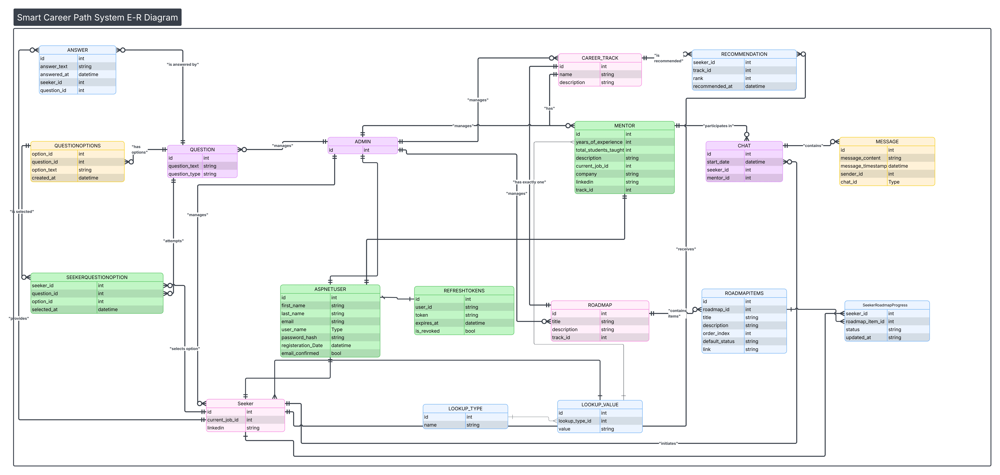

Main tables:

| Table | Purpose |
|---|---|
| `AspNetUsers`, `Seekers`, `Mentors`, `Admins` | Identity plus role-specific profile data (TPT) |
| `RefreshTokens` | Hashed refresh tokens |
| `PasswordResetCodes` | Short-lived 6-digit reset codes |
| `LookupTypes`, `LookupValues` | Admin-managed reference data (for example job titles) |
| `CareerTracks`, `Roadmaps`, `RoadmapItems` | Career content, one roadmap per track |
| `SeekerRoadmapProgress` | Per-seeker progress on each roadmap item |
| `Questions`, `QuestionOptions` | Questionnaire (MCQ and open text) |
| `SeekerQuestionOptions`, `Answers` | Seeker responses (single-select MCQ, open text) |
| `Recommendations` | AI-ranked tracks per seeker |
| `ChatRequests`, `Chats`, `Messages` | Request workflow and conversations |
| `Notifications` | Stored notifications per user |

Integrity is enforced at the database level, not only in code: unique index on `(SeekerId, MentorId)` for chats, a check constraint guaranteeing every message has exactly one sender, and restricted cascade deletes across the schema.

---

## Key Flows

### Recommendation flow

```
Seeker submits answers      POST /api/questions/submit
        │
        ▼
External AI service ranks career tracks
        │
        ▼
AI service saves the result  POST /api/recommendations   (X-Api-Key header)
        │
        ▼
Seeker views results         GET  /api/seekers/me/recommendations
```

The AI service authenticates with a pre-shared API key instead of a JWT, so the two systems stay decoupled. If the AI service is down, the rest of the API keeps working.

### Mentor chat flow

```
Seeker                         Mentor
  │  POST /api/chat-requests     │
  │ ───────────────────────────► │   notification: "New Chat Request"
  │                              │
  │      PUT /api/chat-requests/{id}/accept   (or /decline)
  │ ◄─────────────────────────── │   chat created automatically
  │   notification with chatId   │
  │                              │
  │◄────── SignalR /hubs/chat ──►│   real-time messages, saved to the database
```

### Authentication flow

```
Register / Login ─► access token (15 min) + refresh token (7 days)
        │
        ▼
Refresh ─► old refresh token revoked, new pair issued (rotation)
        │
        ▼
Logout ─► refresh token deleted
```

---

## API Overview

Interactive documentation is available at `/swagger` when the API is running. Every list endpoint accepts `?page=&pageSize=` and returns a paginated envelope.

### Auth: `/api/auth`

| Method | Endpoint | Description |
|---|---|---|
| POST | `/register/seeker` | Register a seeker |
| POST | `/register/mentor` | Register a mentor |
| POST | `/login` | Login |
| POST | `/refresh-token` | Rotate tokens |
| POST | `/logout` | Delete refresh token |
| POST | `/revoke-token` | Mark refresh token revoked |
| GET | `/confirm-email` | Confirm email from the emailed link |
| POST | `/resend-confirmation` | Resend confirmation email |
| POST | `/forgot-password` | Email a 6-digit reset code |
| POST | `/reset-password` | Reset password using the code |

<details>
<summary>Swagger screenshot: Auth</summary>

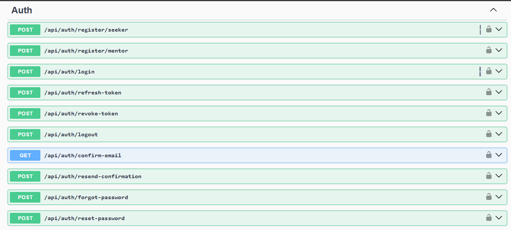

</details>

### Seeker: `/api/seekers/me` (Seeker role)

| Method | Endpoint | Description |
|---|---|---|
| GET / PUT | `/` | View or update profile |
| GET | `/recommendations` | AI-ranked career tracks |
| GET | `/roadmap/{trackId}` | Roadmap with personal progress |
| PUT | `/roadmap/items/{itemId}/status` | Update item progress |

<details>
<summary>Swagger screenshot: Seeker</summary>

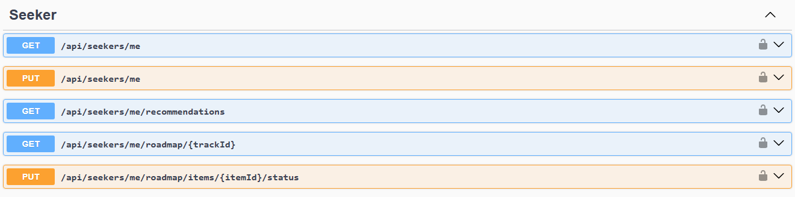

</details>

### Questionnaire and content

| Method | Endpoint | Description |
|---|---|---|
| GET | `/api/questions` | Questionnaire (any authenticated user) |
| POST | `/api/questions/submit` | Submit answers (Seeker) |
| GET | `/api/career-tracks` | List career tracks |
| GET | `/api/lookups` | Public lookup types (registration forms) |
| GET | `/api/lookups/{typeId}/values` | Public lookup values |

<details>
<summary>Swagger screenshot: Questions</summary>

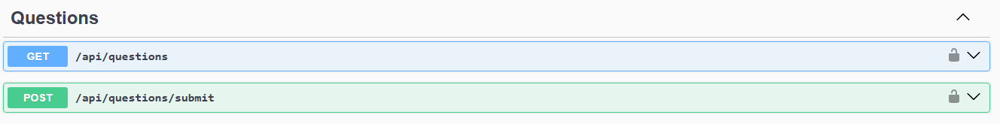

</details>

<details>
<summary>Swagger screenshot: Career tracks</summary>

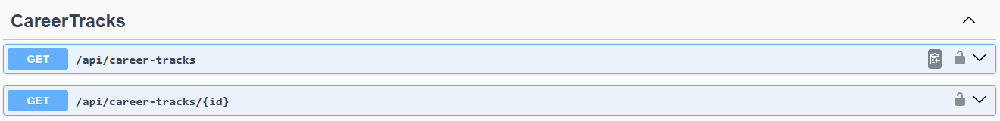

</details>

### Mentors

| Method | Endpoint | Description |
|---|---|---|
| GET | `/api/mentors?search=&trackId=` | Browse and search mentors |
| GET | `/api/mentors/{id}` | Public mentor profile |
| GET / PUT | `/api/mentors/me` | Own profile (Mentor role) |

<details>
<summary>Swagger screenshot: Mentors browsing</summary>

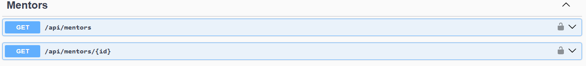

</details>

<details>
<summary>Swagger screenshot: Mentor profile</summary>

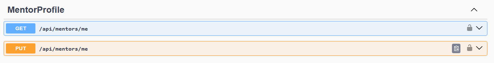

</details>

### Chat requests, chats, notifications

| Method | Endpoint | Role | Description |
|---|---|---|---|
| POST | `/api/chat-requests` | Seeker | Request a chat with a mentor |
| GET | `/api/chat-requests/incoming` | Mentor | Incoming requests (`?status=`) |
| GET | `/api/chat-requests/outgoing` | Seeker | Sent requests (`?status=`) |
| PUT | `/api/chat-requests/{id}/accept` | Mentor | Accept and create the chat |
| PUT | `/api/chat-requests/{id}/decline` | Mentor | Decline |
| GET | `/api/chats` | Any | My conversations |
| GET | `/api/chats/{id}/messages` | Participant | Message history |
| GET | `/api/notifications` | Any | Notification list |
| GET | `/api/notifications/unread-count` | Any | Unread badge count |
| PUT | `/api/notifications/{id}/read` | Any | Mark one as read |
| PUT | `/api/notifications/read-all` | Any | Mark all as read |

<details>
<summary>Swagger screenshot: Chat requests</summary>

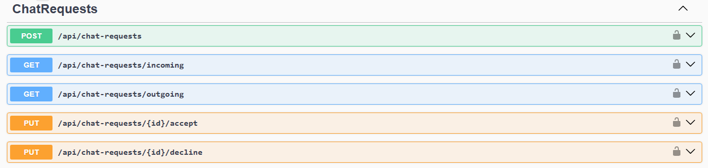

</details>

<details>
<summary>Swagger screenshot: Chats</summary>

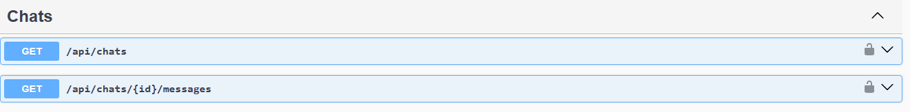

</details>

<details>
<summary>Swagger screenshot: Notifications</summary>

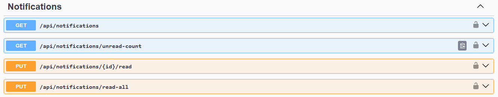

</details>

### SignalR hub: `/hubs/chat`

The JWT is passed as `?access_token=<jwt>` because WebSocket connections cannot send custom headers.

| Direction | Name | Purpose |
|---|---|---|
| Client → Server | `JoinChat(chatId)` | Join a conversation |
| Client → Server | `SendMessage(chatId, content)` | Send a message |
| Client → Server | `LeaveChat(chatId)` | Leave a conversation |
| Server → Client | `JoinedChat` | Join confirmed |
| Server → Client | `ReceiveMessage` | New message for everyone in the chat |
| Server → Client | `Error` | Validation or authorization error |

### AI integration

| Method | Endpoint | Auth | Description |
|---|---|---|---|
| POST | `/api/recommendations` | `X-Api-Key` header | Save ranked tracks for a seeker (replaces previous results) |

```json
{
  "seekerId": "guid",
  "results": [
    { "trackId": 1, "rank": 1 },
    { "trackId": 3, "rank": 2 }
  ]
}
```

<details>
<summary>Swagger screenshot: Recommendations (AI integration)</summary>

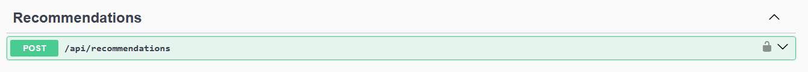

</details>

### Admin (Admin role)

| Area | Endpoints |
|---|---|
| Career tracks | `/api/admin/career-tracks` (CRUD) |
| Roadmaps | `/api/admin/career-tracks/{trackId}/roadmaps`, `/api/admin/roadmaps/{id}` |
| Roadmap items | `/api/admin/roadmaps/{roadmapId}/items`, `/api/admin/roadmap-items/{id}` |
| Questions | `/api/admin/questions` (CRUD, plus options) |
| Lookups | `/api/admin/lookup-types`, `/api/admin/lookup-types/{typeId}/values` |
| Users | `/api/admin/users/seekers`, `/api/admin/users/mentors` (list, view, delete) |

<details>
<summary>Swagger screenshot: Admin career tracks</summary>

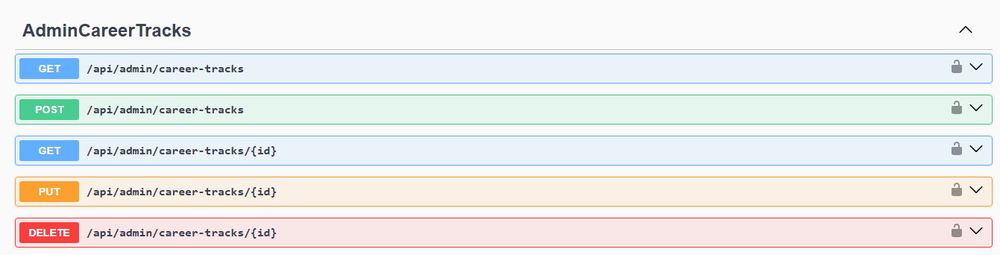

</details>

<details>
<summary>Swagger screenshot: Admin roadmaps</summary>


</details>

<details>
<summary>Swagger screenshot: Admin questions</summary>

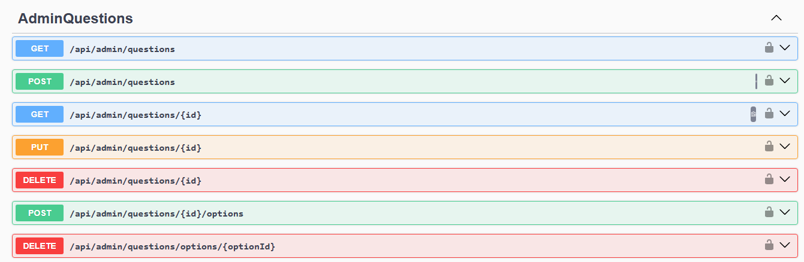

</details>

<details>
<summary>Swagger screenshot: Admin lookups</summary>

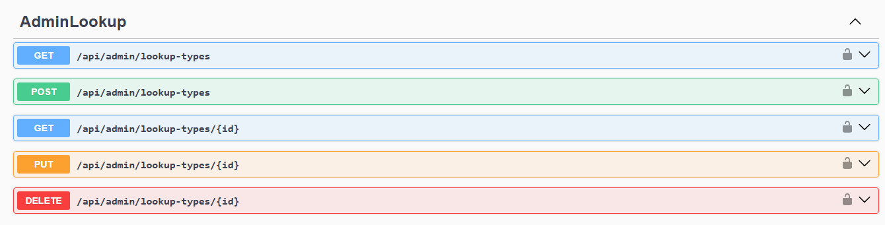

</details>

<details>
<summary>Swagger screenshot: Admin users</summary>

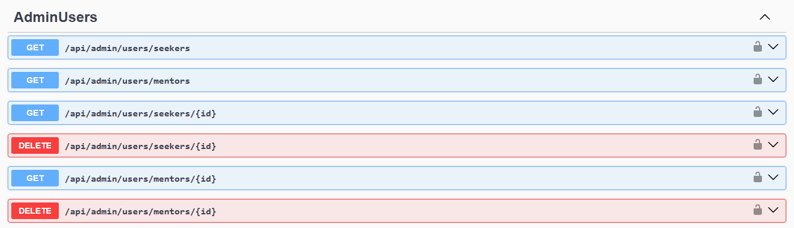

</details>

### Error format

```json
{
  "statusCode": 404,
  "error": "Mentor not found.",
  "traceId": "0HMXXXXXXXX:00000001"
}
```

Validation failures return `{ "statusCode": 400, "error": "Validation failed.", "details": [{ "field": "...", "message": "..." }] }`.

---

## Getting Started

### Prerequisites

- [.NET 8 SDK](https://dotnet.microsoft.com/download/dotnet/8.0)
- SQL Server (local instance, or the Docker setup below)
- EF Core CLI tools: `dotnet tool install --global dotnet-ef`
- A Gmail account with an [App Password](https://support.google.com/accounts/answer/185833) (only needed for emails)

### Run locally

```bash
git clone https://github.com/MAHMOUD-AHMEDD/SmartCareerPath.git
cd SmartCareerPath
```

1. Set your values in `SmartCareerPath.API/appsettings.json` (see [Configuration](#configuration)).
2. Apply the migrations:

```bash
dotnet ef database update --project SmartCareerPath.Infrastructure --startup-project SmartCareerPath.API
```

3. Start the API:

```bash
dotnet run --project SmartCareerPath.API
```

4. Open `/swagger` on the URL printed in the console.

On startup the database seeder creates the three roles (Seeker, Mentor, Admin), a default admin account (`admin@smartcareer.com`), and the initial lookup types. The default admin password is defined in `DataSeeder.cs`. Change it before any real deployment.

---

## Configuration

Settings are read from `appsettings.json` or environment variables. In environment variables, use a double underscore for nesting (`JwtSettings__Secret`).

| Key | Description |
|---|---|
| `ConnectionStrings:DefaultConnection` | SQL Server connection string |
| `JwtSettings:Secret` | Signing key, at least 32 characters |
| `JwtSettings:Issuer` / `Audience` | Token issuer and audience |
| `JwtSettings:AccessTokenExpiryMinutes` | Access token lifetime (default 15) |
| `JwtSettings:RefreshTokenExpiryDays` | Refresh token lifetime (default 7) |
| `ApiKeys:AiService` | Shared secret the AI service sends in `X-Api-Key` |
| `EmailSettings:SenderName` / `SenderEmail` | Sender shown in emails |
| `EmailSettings:AppPassword` | Gmail App Password |
| `EmailSettings:SmtpHost` / `SmtpPort` | `smtp.gmail.com` / `587` |
| `EmailSettings:BaseUrl` | Public base URL of the API, used to build confirmation links |

> Never commit real secrets. Use environment variables or a secret manager for anything beyond local development.

CORS is configured in `Program.cs` (`FrontendPolicy`). Add your frontend origin to the `WithOrigins(...)` list.

---

## Running with Docker

The repository includes a multi-stage `Dockerfile` and a `docker-compose.yml` that starts the API together with SQL Server 2022.

```bash
docker-compose up --build
```

- API: `http://localhost:8080`
- Swagger: `http://localhost:8080/swagger`
- Health check: `http://localhost:8080/health`

Update the placeholder secrets in `docker-compose.yml` first. Migrations are not run inside the container; apply them from your machine against the exposed SQL Server port (1433) using the command in [Run locally](#run-locally).

---

## Testing

The test project uses xUnit with `WebApplicationFactory` and an in-memory database.

```bash
dotnet test SmartCareerPath.Tests
```

---

## Deployment

The project is containerized and designed for a low-cost AWS setup: the API image runs on an **EC2** instance and the database on **RDS for SQL Server**, with all secrets injected as environment variables. The full step-by-step procedure (security groups, Docker Hub image flow, environment variables, migrations, redeploy workflow) is documented in the project's Phase 10 notes.

---

## Design Decisions

- **Clean Architecture** keeps business contracts independent of infrastructure, so persistence, email, and auth can change without touching the application layer.
- **TPT inheritance** gives each role its own table while sharing one Identity user store.
- **Refresh token rotation with hashed storage**: a stolen refresh token cannot be reused, and a database leak does not expose usable tokens.
- **Defense in depth on chat**: the hub and the service layer both verify chat membership, and the database enforces the one-chat-per-pair and one-sender-per-message rules.
- **Request-first chat**: chats exist only after a mentor accepts, so seekers cannot message mentors directly.
- **Decoupled AI integration**: a single API-key-secured endpoint, with no runtime dependency on the AI service.
- **Per-seeker roadmap progress** is stored separately from the roadmap template, so one seeker's progress never affects another's.
- **No account enumeration**: password reset and email confirmation endpoints return uniform responses regardless of whether an email exists.

### Known tradeoffs

- The SignalR JWT travels in the query string, which is common for WebSockets but can appear in server logs. A short-lived token exchange would be the production alternative.
- Notifications are fetched over REST rather than pushed in real time.
- One refresh token per user (single active session).
- No rate limiting.


